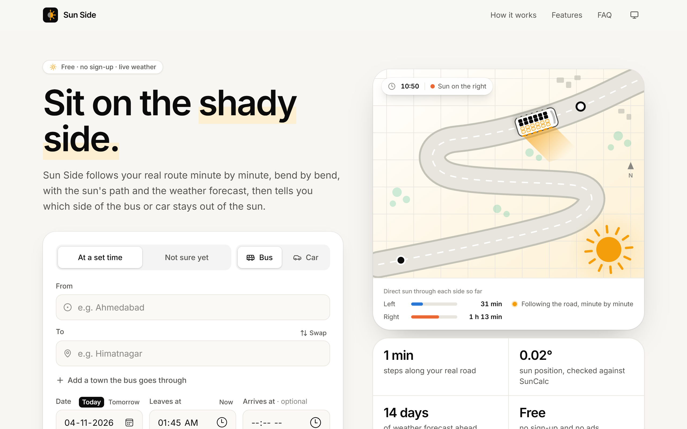
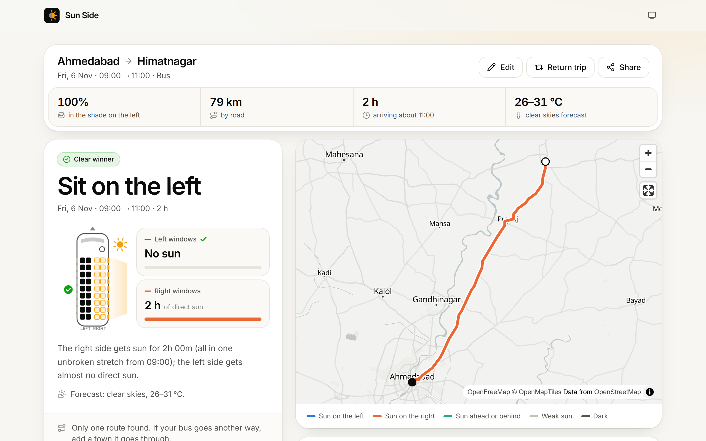
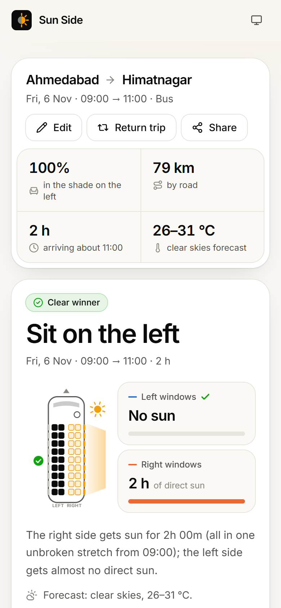
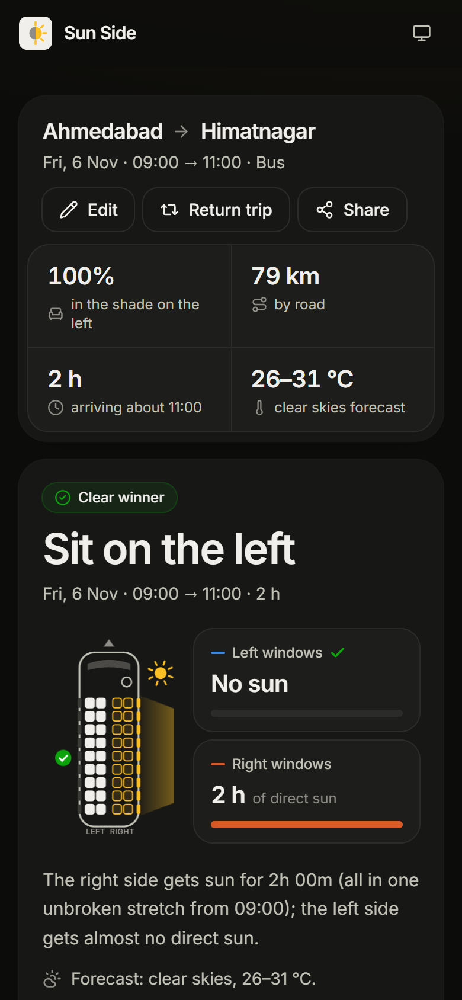
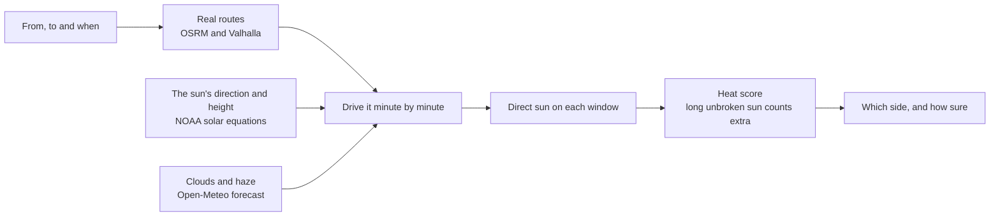

<div align="center">


# Sun Side

**Sit on the shady side.** Sun Side tells bus and car travellers which side to sit on to stay
out of the sun, worked out minute by minute along the real road, with the sun's path and the
weather forecast.

### [Open Sun Side →](https://sun-side.pages.dev)

[](https://github.com/PatelDhruv01/sun-side/actions/workflows/ci.yml)
[](https://sun-side.pages.dev)
[](LICENSE)


</div>

<picture>
  <source media="(prefers-color-scheme: dark)" srcset="docs/screenshots/home-dark.png">
  
</picture>

## Why

Pick the wrong side of a bus and you can sit in direct sun for hours. Guessing from the
direction of your destination often goes wrong:

- **Roads bend.** A road that heads north overall can spend half an hour heading west.
- **The sun moves and climbs.** A side window gets the most sun around 30° of sun height, in
  mid-morning and mid-afternoon; at noon it mostly lands on the roof.
- **"The sun is in the south" doesn't always hold.** In Chennai in May the noon sun is in the
  north.
- **Speed changes the answer.** Mumbai → Goa leaving at 7: at car speed the left side gets more
  sun; at a real bus's pace the afternoon wins and it's the right.

Sun Side follows the trip from start to finish instead of guessing.

## Features

- **Your real route, bend by bend.** Roads from OpenStreetMap, other routes checked too, and you
  can pin the towns your bus goes through.
- **The sun, minute by minute.** Its direction and height for every minute of the trip, from
  NOAA's solar equations, checked against SunCalc to within 0.02°.
- **The weather.** Clouds and haze from the Open-Meteo forecast dim the sun, up to 14 days ahead.
- **An honest answer.** Clear winner, slight edge, about even, little sun or after dark; and
  whether leaving a little earlier or later would change it.
- **Not sure when you'll leave?** It checks every departure that day, half an hour apart, and
  says which side to take for each part of the day.
- **Worth moving seats?** On long trips the sun can swap sides; it says when a move pays off,
  and when the front or back rows get the low sun.
- **Play the trip.** The timeline runs and the bus moves along the map, with the sun's
  direction and its lit side, minute by minute.
- **Share it, plan the way back.** Every answer has its own link; Return trip works out the
  whole day for the way home. Your recent trips stay in your browser.
- **Made for phones,** light or dark, and it can be added to a home screen. Free, no sign-up,
  no ads.

<picture>
  <source media="(prefers-color-scheme: dark)" srcset="docs/screenshots/answer-dark.png">
  
</picture>

<p align="center">
  
  &nbsp;&nbsp;
  
</p>

## How it works



1. **Places:** Photon finds towns, bus stands and streets; when it's unreachable (it often is),
   Open-Meteo's place search covers towns and cities.
2. **Routes** ([routing.ts](src/services/routing.ts)): OSRM gives the road as a polyline plus the
   driving time of every little segment. Valhalla adds alternative routes, which OSRM rarely
   finds; its own times run far too slow for India, so they're rescaled against OSRM's. Routes
   that differ only by a few streets out of town (all but 15 km and 80% shared) count as one.
   Each route is labelled by the roads that set it apart ("via NH147, SH41"). Via towns pin
   the route; neither engine offers alternatives then.
3. **Timing** ([timing.ts](src/engine/timing.ts)): OSRM's times assume free-flowing traffic, so
   without a ticket the timeline uses a typical trip: 1.5× for a bus, 1.25× for a car (rough
   factors from usual Indian journey times). With the arrival time from a ticket, it's
   stretched to fit exactly.
4. **Sun:** for every segment, the sun's direction and height at that place and time
   ([NOAA's equations](src/engine/solar.ts), checked against the SunCalc library to within 0.02°).
5. **Sunlight:** clear-sky direct sunlight for that sun height, split onto the left, right,
   front and rear windows by the angle between the road and the sun. Windows are treated as
   vertical, so a high noon sun mostly lands on the roof.
6. **Weather** ([weather.ts](src/engine/weather.ts)): for dates up to about two weeks ahead,
   Open-Meteo's hourly forecast for each 0.5° square (about 55 km) the routes cross. Each hour it
   says how much of the clear-sky sun gets through (clouds, and haze, which takes 5–20% even on
   clear days); that share scales the minute-by-minute clear-sky value, so a cloudy stretch counts
   for less. Beyond the forecast, a clear sky.
7. **Timeline:** segments are summed into one-minute bins.
8. **Verdict** ([decide.ts](src/engine/decide.ts)): each window gets a "heat bucket" that sun
   fills and shade drains (15-minute cool-down). The heat score adds up how full the bucket
   is, squared, so one long unbroken stretch counts for more than the same sun in short
   bursts: 60 unbroken minutes score like about 95 minutes in 10-minute bursts. Then:
   - the side with the lower score wins: "clear" if the other is at least twice as bad and
     about 20 strong-sun minutes worse, otherwise "only slightly better";
   - within 15% of each other is "either", with a lean to the side with less low sun in
     your eyes (glare) when that differs by 10+ minutes;
   - very little heat on both sides is "either" too;
   - a single seat change is suggested when it cuts the heat by at least 25%;
   - a rows tip appears when the windscreen or rear window gets a lot of sun.
9. **Checks** ([evaluate.ts](src/engine/evaluate.ts)): the verdict is worked out for every route
   found and for leaving 30 minutes early, 30 minutes late and an hour late, and the answer says
   whether they agree.
10. **Not sure when** ([sweep.ts](src/engine/sweep.ts)): the verdict for every departure that day,
    half an hour apart, joined into runs that share one ("either side" split by why: after dark,
    little sun, or about even).

Everything runs in the browser: there's no server of its own, no account and no tracking code.

## Accuracy and limits

- The sun's position is exact to a fraction of a degree. The rest depends on the route and the
  timing: give the arrival time from your ticket, and add a town the bus goes through if it
  takes another road.
- The forecast reaches about two weeks ahead, in 0.5° squares; further out it's a clear sky,
  the worst case.
- Without a ticket time, the typical bus and car factors are rough guesses.
- Stops along the way aren't modelled; their time is spread over the whole trip.
- Alternatives depend on what the free routing engines return; often there's only one route.
- No shade from hills, buildings or trees.
- The scoring thresholds are first guesses, to be tuned on real trips.
- Times are read and shown in the reader's own time zone.

## Run it yourself

Needs [Node.js](https://nodejs.org) 22.18 or newer (it runs the TypeScript directly; Node 24 is
what the site is built with). Everything it uses is free and needs no keys.

```bash
git clone https://github.com/PatelDhruv01/sun-side.git
cd sun-side
npm install
npm run dev
```

The page is then at http://localhost:5173.

| Script | What it does |
|---|---|
| `npm run dev` | The page with live reload |
| `npm test` | The checks (`node:test`, no network needed) |
| `npm run typecheck` | TypeScript, without building |
| `npm run build` | The static site, in `dist/` |
| `npm run preview` | Serves the built site locally |
| `npm run trip -- …` | The command-line trip tool (below) |

### The command line

The same engine runs from the command line, with more detail and knobs:

```bash
npm run trip -- --from "Ahmedabad" --to "Himatnagar" --depart "2026-11-15 09:00" --arrive "11:00"
npm run trip -- --from "Ahmedabad" --to "Himatnagar" --depart "2026-11-15" --hours 2
```

| Option | Meaning |
|---|---|
| `--from`, `--to` | A place name (`"Swargate, Pune"`) or `"lat,lon"` as Google Maps shows it |
| `--via` | A town the bus goes through, to pin the route (repeat for more) |
| `--depart` | `"YYYY-MM-DD HH:MM"`, `"HH:MM"` (today) or `now`; a date alone works out every departure that day |
| `--arrive` | Arrival time from your ticket: stretches the timeline to fit |
| `--hours` | With a date alone: how long the trip takes |
| `--vehicle` | `bus` (default) or `car`: a typical trip time when `--arrive` isn't given |
| `--scale` | Or stretch by hand: `1.3` = 30% slower than the free-flowing car time |
| `--route` | Which of the routes found to show in detail (default 1, the quickest) |
| `--tz` | UTC offset of the times you type (default `+05:30`, IST) |
| `--every` | Minutes per row of the printed timeline (default 10) |
| `--continuity` | How much long unbroken sun matters: `1` = only the total, `2` = default, `3` = a lot |
| `--cool-down` | Minutes to cool off once out of the sun (default 15) |
| `--no-weather` | Assume a clear sky instead of using the forecast |
| `--refresh` | Ignore cached lookups, forecasts included |

Each run prints a verdict (which side, how sure, and why), whether the other routes and a
slightly earlier or later departure agree, the sun on each side and a timeline, and writes two
files to `out/`:

- a `.csv` with one row per minute (time, position, heading, sun direction and height, W/m² on each face);
- a `.geojson` map: drop it on [geojson.io](https://geojson.io) to see the route coloured by sunny side
  (blue = left, orange = right, aqua = ahead or behind, light grey = weak sun, dark grey = night),
  with the other routes in thin grey. These are the web page's colours too: categorical slots 1–3
  of a palette checked for colour-blind separation in light and dark mode.

## Project layout

| Folder | What's in it |
|---|---|
| [`src/engine`](src/engine) | The sun, the simulation and the verdict: pure TypeScript, runs in Node and the browser |
| [`src/services`](src/services) | Free web APIs: OSRM and Valhalla routing, Photon and Open-Meteo place search, the forecast |
| [`src/app`](src/app) | Shared by the page and the command line: the trip pipeline, the verdict in words, map stretches |
| [`src/web`](src/web) | The web page: React, Tailwind CSS and MapLibre, built with Vite |
| [`src/cli`](src/cli) | The `trip` command-line tool |
| [`test`](test) | `node:test` checks: hand-checkable directions, a SunCalc cross-check, synthetic roads, fake API answers |
| [`public`](public) | Files served as they are: the icon, the web app manifest and the response headers |

## Deployment

The live site is on [Cloudflare Pages](https://pages.cloudflare.com), connected to this
repository:

- every push to `main` is built (`npm run build`, output `dist/`, Node from `.node-version`) and
  goes live at [sun-side.pages.dev](https://sun-side.pages.dev);
- every other branch gets its own preview link;
- [`public/_headers`](public/_headers) keeps the content-hashed assets cached for a year and adds
  the security headers.

It's a plain static site, so any static host works the same way.

## Data and credits

Map data © [OpenStreetMap](https://www.openstreetmap.org/copyright) contributors (ODbL); map
tiles by [OpenFreeMap](https://openfreemap.org) and [OpenMapTiles](https://openmaptiles.org).
Routes by [OSRM](https://project-osrm.org) and [Valhalla](https://valhalla.github.io/valhalla/)
on [FOSSGIS](https://www.fossgis.de)'s public servers. Places by
[Photon](https://photon.komoot.io) (komoot) and [Open-Meteo](https://open-meteo.com) (GeoNames
data). Weather by [Open-Meteo](https://open-meteo.com) (CC BY 4.0). Sun position from
[NOAA's solar equations](https://gml.noaa.gov/grad/solcalc/).

These are free, shared services, for fair, non-commercial use: the routing servers ask for at
most one request a second. The page fetches each address once per visit, waits for a pause in
typing before searching and retries a failed request once; the command line caches responses
in `cache/`.

## Roadmap

1. ~~Sun engine~~
2. ~~Scoring: the "heat bucket" for unbroken vs broken sun, honest "doesn't matter" answers, seat switching~~
3. ~~Routes and timing: place search, via points, alternatives, ticket-time stretch~~
4. ~~Web page: inputs, map, verdict, timeline~~
5. ~~"Not sure when I leave" and the weather forecast~~
6. ~~Polish and free deploy: landing page, live demo, sharing, return trip, themes, phones, Cloudflare Pages~~

Next: a domain of its own, and tuning the scoring thresholds on real trips. Ideas and reports
of a wrong side are welcome in the [issues](https://github.com/PatelDhruv01/sun-side/issues).

## Contributing

Bug reports, wrong answers and ideas are all useful: see [CONTRIBUTING.md](CONTRIBUTING.md) for
how to get set up and what to check before a pull request. Please follow the
[code of conduct](CODE_OF_CONDUCT.md), and report security problems privately as
[SECURITY.md](SECURITY.md) describes.

## Licence

The code is under the [MIT licence](LICENSE). The data it shows keeps its own licences:
OpenStreetMap's ODbL and Open-Meteo's CC BY 4.0, credited above.
